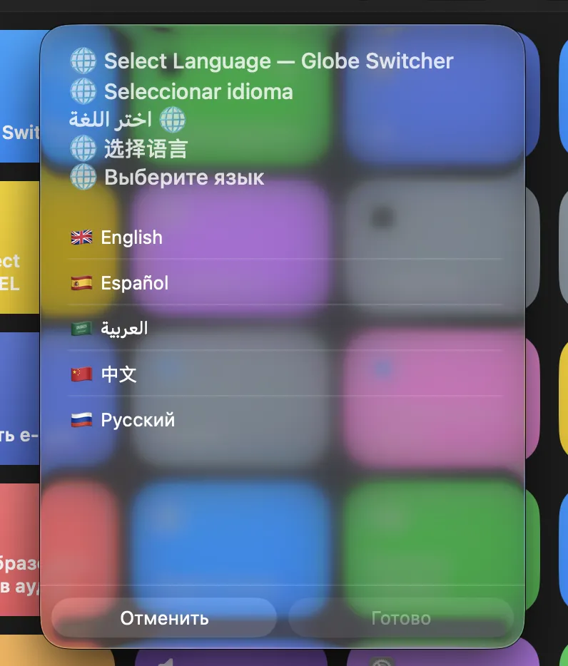
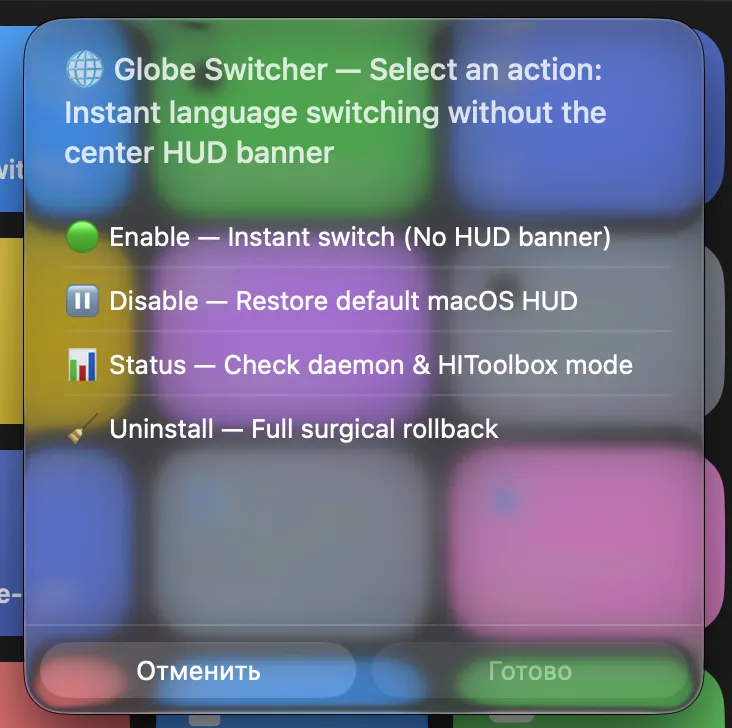
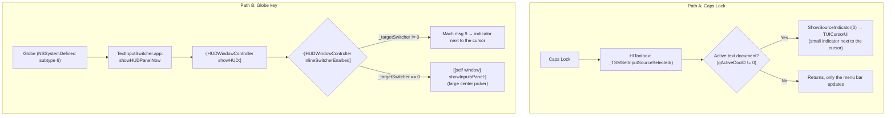
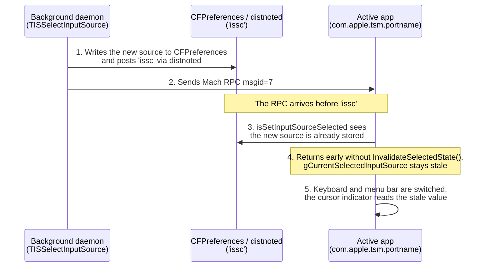

# Globe Switcher for macOS

**English | [Русский](README.ru.md)**

Instant language switching with the Globe (🌐/Fn) key on macOS, without the big center-screen language picker. It keeps the small indicator next to the text cursor, Globe+Delete, and Caps Lock, and needs no Accessibility or Input Monitoring permission.

On macOS, switching with Caps Lock is instant and never shows the large picker in the middle of the screen. The Globe key does show it (when no text field is focused) and switches with a delay. Globe Switcher is a small Swift LaunchAgent that sends the Globe key through the same code path Caps Lock uses.

| Large center HUD (removed) | Small cursor indicator (kept) |
| :---: | :---: |
|  |  |

## What changes

| | Default macOS (Globe key) | With Globe Switcher |
| :--- | :--- | :--- |
| Switch delay | Noticeable | None |
| Large center picker | Shown when no text field is focused | Not shown |
| Indicator next to the cursor | Shown | Shown |
| Globe+Delete (forward delete), Fn+F1–F12 | Work | Work |
| Caps Lock for uppercase | Works | Works |
| Accessibility / Input Monitoring permission | Not needed | Not needed |
| After reboot | n/a | Starts at login (LaunchAgent) |
| Removal | n/a | One command or one Shortcut action, restores your original setting immediately |

## Install with the Apple Shortcut

[Get the Shortcut (iCloud)](https://www.icloud.com/shortcuts/faa3b699eec641aab741d97baf88fe57)

> [!IMPORTANT]
> Before you run it for the first time, open Shortcuts, press **⌘,** (Settings), go to **Advanced**, and turn on **Allow Running Scripts**. macOS blocks shell scripts in Shortcuts until you do. You only need to do this once. The Shortcut also has a "First run" menu item that explains this and works while scripts are still disabled.


1. Choose your language on the first screen: English (default), Español, العربية, 中文 or Русский.
2. Choose **Enable**.
3. That's it. You don't need the Shortcut after this. The daemon starts at login on its own. Open it again only to pause, check status, or uninstall.

| Language picker | Action menu | Status |
| :---: | :---: | :---: |
|  |  |  |

The binary inside the Shortcut is built from [`GlobeSwitcher.swift`](GlobeSwitcher.swift) (`swiftc -O -parse-as-library -target arm64-apple-macos13.0`, then `strip -x`). SHA-256 before the local ad-hoc signature:

```text
9314b5ac579fcf08e60c2215249b9f401bbc400d323852079d01368bb11a64cc  globe-switcher
```

If you'd rather not run a prebuilt binary, build it yourself.

## Build from source

```zsh
# Needs Xcode Command Line Tools (Apple Silicon / arm64, macOS 13.0+)
swiftc -O -parse-as-library -target arm64-apple-macos13.0 GlobeSwitcher.swift -o globe-switcher
strip -x globe-switcher
codesign -s - -f globe-switcher

./manage.sh on         # install the LaunchAgent and set AppleFnUsageType = 0
./manage.sh status     # daemon and HIToolbox state
./manage.sh off        # pause, restores the default behavior
./manage.sh uninstall  # remove everything and restore the original setting
```

## Without any script

This works with settings only, and I used it for years before writing this tool:

1. System Settings → Keyboard → Input Sources: turn on "Use the Caps Lock key to switch to and from ABC".
2. Keyboard Shortcuts → Modifier Keys: set the Globe key to Caps Lock.

You lose Globe+Delete, and Caps Lock needs a slightly longer press.

## How it works

### Why `TSMLanguageIndicatorEnabled` doesn't help

A commonly shared tip is:

```zsh
defaults write kCFPreferencesAnyApplication TSMLanguageIndicatorEnabled -bool false
```

It does the opposite of what's wanted here. It turns off the small indicator next to the cursor and brings the big picker back everywhere.

### Two code paths

I disassembled `TextInputSwitcher.app`, `TextInputMenuUI.framework` and `HIToolbox.framework` in lldb. Caps Lock and the Globe key take different paths.



**Path B (Globe).** With `AppleFnUsageType = 1`, pressing Globe sends an `NSSystemDefined` event (`subtype = 6`, `data1 = 0x3e7`) to `TextInputSwitcher.app`, which calls `showHUDPanelNow` and then `-[HUDWindowController showHUD:]`. That checks `-[HUDWindowController inlineSwitcherEnalbed]` (the typo is in Apple's binary). The method looks at the `redesigned_text_cursor` feature flag, `TSMLanguageIndicatorEnabled`, and `_targetSwitcher`, the active app's `ProcessSerialNumber` registered through Mach message `13`. With no focused text field, `_targetSwitcher == 0`, and the code calls `showInputsPanel:` unconditionally. No `defaults` key controls that branch.

**Path A (Caps Lock).** `ProcessCapsLockModifierChangedEvent` runs inside `HIToolbox` without involving `TextInputSwitcher.app`. After `_TSMSetInputSourceSelected` it calls `ShowSourceIndicator(0)`. `ShowSourceIndicator_TimerHandler` first reads `gActiveDocID` and returns if it's zero.

### What the daemon does

It sets `AppleFnUsageType = 0` so the system ignores a plain Globe tap, handles the tap itself, and switches through `HIToolbox`.

**No permissions needed.** Globe+Backspace (forward delete), Globe+arrows and Globe+F-keys are translated by the keyboard driver before events reach user processes, so they keep working. The daemon uses a global `NSEvent` monitor for `.flagsChanged` (works without TCC) and, on Globe release, asks WindowServer how long ago the last key or click happened:

```swift
let sinceLastKeyDown = CGEventSource.secondsSinceLastEventType(.combinedSessionState, eventType: .keyDown)
let sinceLastLeftClick = CGEventSource.secondsSinceLastEventType(.combinedSessionState, eventType: .leftMouseDown)
let sinceLastRightClick = CGEventSource.secondsSinceLastEventType(.combinedSessionState, eventType: .rightMouseDown)
```

These calls don't reveal which key was pressed, so they need no permission, but they show whether anything was pressed while Globe was held. `keyUp` is ignored so fast typing doesn't cancel a switch. `.capsLock` is excluded from the "other modifiers" mask, so Globe works with Caps Lock on.

**A race in HIToolbox.** Calling `TISSelectInputSource()` from a background process sometimes left the indicator next to the cursor showing the previous language while the menu bar was correct.



To avoid it, the daemon doesn't call `TISSelectInputSource()` itself. It finds the app that has keyboard focus (`SLPSGetKeyFocusProcess` from SkyLight, then `GetProcessPID`), flattens the target input source with `_CreateFlattenedInputSource`, packs it into a binary property list (`{"tsmInputSourceSelectedInpSrcKey": flatDict}`) and sends it as Mach message `msgid = 7` to that app's `com.apple.tsm.portname` (`CFMessagePortCreatePerProcessRemote`). The app then updates its own state in one thread.

On arm64e, `SLPSGetKeyFocusProcess` takes two out-pointers: `ProcessSerialNumber*` in `x0` and `UInt8*` in `x1`. Declaring it with one argument crashes optimized builds with `EXC_BAD_ACCESS` at `strb w8, [x20]` (+364).

**Immediate rollback.** `defaults write com.apple.HIToolbox AppleFnUsageType -int 1` doesn't make system processes re-read the setting. `TISUpdateFnUsageType(Int32)` writes the preference and broadcasts `BroadcastToolboxMessage('fnsc', 0)`, so enabling, pausing and uninstalling take effect without a reboot.

**Packaging in the Shortcut.** The binary is stored as `gzip -9` plus `base64` (about 17 KB). On install it's unpacked to `$BIN_PATH.tmp.$$`, signed with the built-in `/usr/bin/codesign -s - -f`, and moved into place with `mv -f`. Overwriting an existing executable on Apple Silicon can get the process killed (`SIGKILL`) because the code-signature cache is tied to the file's vnode.

## FAQ

**How do I get rid of the big language picker on macOS and keep the small cursor indicator?**
Use Globe Switcher (Shortcut or build from source). It routes the Globe key through the same code path Caps Lock uses.

**Does it need Accessibility or Input Monitoring permission?**
No.

**Does Globe+Delete still work?**
Yes. Globe+Delete, Globe+arrows and Fn+F-keys are handled by the keyboard driver.

**Does it survive a reboot?**
Yes, it's a regular user LaunchAgent (`local.globe-switcher`) that starts at login.

**What if macOS changes?**
The tool uses private system symbols, so a future macOS release may break it. If that happens, run Uninstall to restore the original setting, and please open an issue.

**How do I remove it?**
Run the Shortcut and choose Uninstall, or run `./manage.sh uninstall`.

## Files

- [`GlobeSwitcher.swift`](GlobeSwitcher.swift): the daemon, one file, no dependencies.
- [`manage.sh`](manage.sh): install, status, pause and uninstall.
- [`local.globe-switcher.plist`](local.globe-switcher.plist): launchd user agent.
- [`shortcut-all-in-one.sh`](shortcut-all-in-one.sh): the script embedded in the Shortcut.
- [`Globe Switcher.shortcut`](Globe%20Switcher.shortcut): the signed Shortcut.

## License

MIT.

## Author

Vladislav Kasatkin (`vladkas`). More on the background and a no-script workaround: [vladkas.com](https://vladkas.com/blog/globe-switcher-shortcut/) (in Russian).
