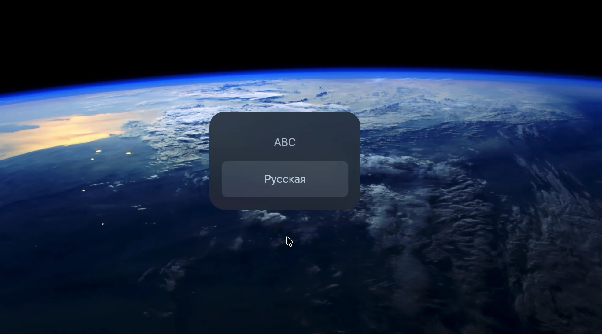
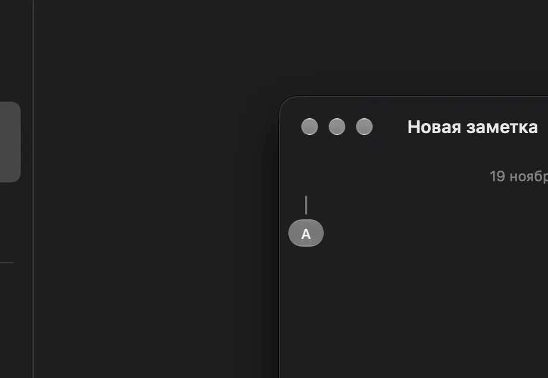
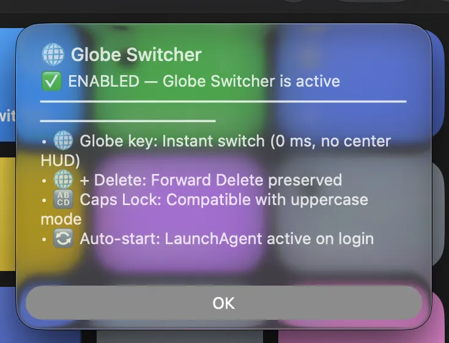
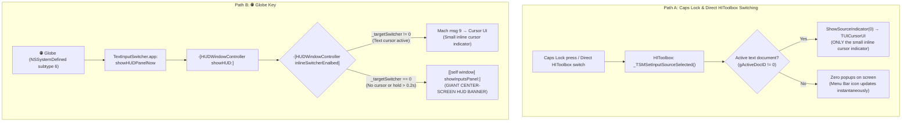
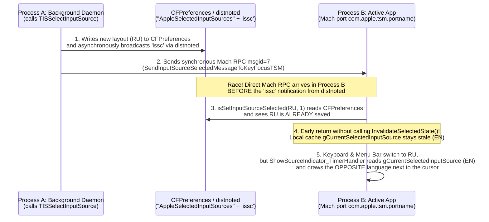

# 🌐 Globe Switcher for macOS — Instant Input Source Switching Without the Center HUD Banner

**🇬🇧 English | 🇷🇺 [Русский](README.ru.md)**

[](#)
[-blue)](#)
[](#1-zero-tcc-distinguishing-globe-from-globe--delete-without-accessibility-permissions)
[](#license)

**Fix slow `🌐 Globe` (`Fn`) key language switching and permanently disable the giant center-screen language switcher popup (`HUDPanel`) on macOS — while keeping the sleek inline cursor language indicator (`TUICursorUI`), `🌐 + Delete` (Forward Delete), `Caps Lock` uppercase mode, and requiring zero Accessibility or Input Monitoring permissions (Zero-TCC).**

> **TL;DR:** On macOS Sonoma and newer, there are three built-in ways to switch input sources: the `🌐 Globe` (`Fn`) key, `Control + Space`, and `Caps Lock` (enabled separately in Settings). Switching with `Caps Lock` is instant (`0 ms`) and never shows the giant center-screen popup, whereas pressing `🌐 Globe` (`Fn`) triggers `TextInputSwitcher.app` and pops up a laggy center HUD banner whenever no text cursor is active. **Globe Switcher** is a lightweight native Swift `LaunchAgent` (`0.0% CPU`, ~3 MB RAM) that routes `🌐 Globe` through the exact same native `HIToolbox` path as `Caps Lock`.

| ❌ Giant Center-Screen HUD (Removed) | ✅ Small Inline Cursor Indicator (Preserved) |
| :---: | :---: |
|  |  |

---

## ✨ Features & Comparison

| Feature | Default macOS (`🌐 Globe`) | **Globe Switcher** |
| :--- | :---: | :---: |
| **Input source switch latency** | Noticeable delay + HUD animation | **0 ms (instant)** |
| **Giant center-screen HUD popup (`HUDPanel`)** | Pops up whenever no text field is focused | **Never appears** |
| **Small inline cursor indicator (`TUICursorUI`)** | Shown when typing | **Preserved (native)** |
| **`🌐 Globe + Delete` (Forward Delete) & `Fn + F1..F12`** | Works | **100% preserved** |
| **`Caps Lock` (UPPERCASE mode) compatibility** | Works | **100% preserved** |
| **Accessibility / Input Monitoring (TCC) permissions** | — | **None required (Zero-TCC)** |
| **Persists automatically after reboot** | — | **Yes (`LaunchAgent`, `0.0% CPU`, ~3 MB RAM)** |
| **Instant surgical rollback (no reboot)** | — | **Yes, 1 click** |

---

## 🚀 Quick Install (1-Click Apple Shortcut via iCloud)

The easiest way to install and manage **Globe Switcher** without Terminal or Xcode is the self-contained Apple Shortcut:

👉 **[Get Globe Switcher (iCloud Shortcut)](https://www.icloud.com/shortcuts/6fd29c90d5bf44518194368ff03fc031)**

> [!IMPORTANT]
> **Do this BEFORE running the Shortcut for the first time:**
> By default on macOS, **Shortcuts.app** blocks shell scripts. Open **Shortcuts.app**, press **`⌘,`** (Settings) → **Advanced** → check **Allow Running Scripts**.
> This is a safe one-time setting required for the installer to run. *(The Shortcut also includes a built-in **🔓 First run? Enable scripts (10 sec)** help button that works even before you tick the box.)*

### Good to Know

1. **5-Language UI Built In:**
   Step 1 of the Shortcut lets you choose your interface language:
   `🇬🇧 English` (default) · `🇪🇸 Español` · `🇸🇦 العربية` · `🇨🇳 中文` · `🇷🇺 Русский`.

| Language Selector | Action Menu | Active Status |
| :---: | :---: | :---: |
|  |  |  |

2. **You Only Need to Run the Shortcut Once:**
   Clicking **🟢 Enable** unpacks the native binary to `~/.local/share/globe-switcher/` and registers a standard user `LaunchAgent` (`~/Library/LaunchAgents/local.globe-switcher.plist`). **Globe Switcher will continue working automatically in the background even after rebooting your Mac.** You only need to open the Shortcut again if you want to pause (**⏸️ Disable**), check **📊 Status**, or perform a **🧹 Uninstall (Full surgical rollback)**.

3. **Embedded Binary Verification (SHA-256):**
   The `arm64` binary embedded inside the Shortcut is compiled directly from [`GlobeSwitcher.swift`](GlobeSwitcher.swift) (`swiftc -O -parse-as-library` + `strip -x`). You can verify its exact checksum before ad-hoc signing:
   ```text
   2015eb73f5a57648a765f403716528170f27445c331b3ec2cad4c2d363e57ee1  globe-switcher
   ```
   *(Or inspect and compile [`GlobeSwitcher.swift`](GlobeSwitcher.swift) yourself using the steps below.)*

---

## 🛠️ Manual Installation (Build from Source)

Developers can audit every line of [`GlobeSwitcher.swift`](GlobeSwitcher.swift), compile it locally with `swiftc`, and manage it via [`manage.sh`](manage.sh):

```zsh
# 1. Compile the native arm64 binary (requires Xcode Command Line Tools)
swiftc -O -parse-as-library GlobeSwitcher.swift -o globe-switcher
strip -x globe-switcher
codesign -s - -f globe-switcher

# 2. Enable (installs LaunchAgent and sets AppleFnUsageType = 0)
./manage.sh on

# Check daemon & HIToolbox status
./manage.sh status

# Pause (instantly restores default macOS HUD behavior)
./manage.sh off

# Full surgical rollback (removes binary, LaunchAgent plist, and restores original Fn setting)
./manage.sh uninstall
```

---

## 🔬 Reverse-Engineering Deep Dive: How macOS Language Switching Actually Works

### 1. Why `TSMLanguageIndicatorEnabled` Does NOT Fix This Problem
A widely shared workaround on forums and blogs suggests running:
```zsh
defaults write kCFPreferencesAnyApplication TSMLanguageIndicatorEnabled -bool false
```
Disassembling macOS system frameworks in `lldb` reveals that this command does the **exact opposite** of what most users want: it disables the *new small inline cursor indicator* and forces macOS back to the *old giant center-screen HUD banner* everywhere.

### 2. The Discovery: Two Completely Different Architectural Paths in macOS

Disassembling three system binaries from `dyld_shared_cache` — **`TextInputSwitcher.app`**, **`TextInputMenuUI.framework`**, and **`HIToolbox.framework`** — revealed why `Caps Lock` never shows the center banner while `🌐 Globe` and `⌃Space` always do:



#### Why Path B (`🌐 Globe`) Cannot Disable the Center Banner via `defaults`:
1. When `AppleFnUsageType = 1` ("Change Input Source"), pressing `🌐 Globe` sends an `NSSystemDefined` event (`subtype = 6`, `data1 = 0x3e7`) to `TextInputSwitcher.app`.
2. `TextInputSwitcher` calls `showHUDPanelNow` → `-[HUDWindowController showHUD:]` (`TextInputMenuUI.framework`).
3. Inside `showHUD:`, macOS checks **`-[HUDWindowController inlineSwitcherEnalbed]`** *(yes, Apple's own typo `Enalbed` exists in the binary)*. It verifies `_os_feature_enabled_impl("UIKit", "redesigned_text_cursor")`, `TSMLanguageIndicatorEnabled`, and **`self->_targetSwitcher`** (the active app's `ProcessSerialNumber`, registered via Mach message `13` — `@"register switcher"`).
4. Whenever no text field is focused (`_targetSwitcher == 0`), `inlineSwitcherEnalbed` returns `NO` and the code **unconditionally** executes:
   ```objc
   [[self window] setCollectionBehavior:0x401];
   [[self window] showInputsPanel:selectionIndex];
   ```
   There is no `defaults` key in this branch.

#### Why Path A (`Caps Lock`) Never Shows the Center Banner:
`ProcessCapsLockModifierChangedEvent` runs **directly inside `HIToolbox.framework`**, bypassing `TextInputSwitcher.app` completely. After `_TSMSetInputSourceSelected`, it invokes `ShowSourceIndicator(0)` → `ShowSourceIndicator_TimerHandler`, whose very first check is `gActiveDocID`:
- If `gActiveDocID == 0` (no active text cursor), it immediately returns (`retab`). No center banner exists in this code path.
- If `gActiveDocID != 0`, it queries caret coordinates (`SendTextInputOffsetToPosEvent_WithCompletionHandler`) and renders **only the small inline cursor indicator**.

---

## 🧠 Core Engineering Solutions in `GlobeSwitcher.swift`

To move `🌐 Globe` onto **Path A**, the daemon sets `AppleFnUsageType = 0` ("Do Nothing" for single `🌐` taps), listens for clean `🌐 Globe` taps itself, and triggers native `HIToolbox` switching.

### 1. Zero-TCC: Distinguishing `🌐 Globe` from `🌐 Globe + Delete` Without Accessibility Permissions
Keyboard remappers typically require **Accessibility** or **Input Monitoring** permissions (`CGEventTap` / `IOHIDManager`). `globe-switcher` requires **zero TCC permissions**:
- Chords like `🌐 + Backspace → Forward Delete (0x75)`, `🌐 + Arrow keys → Home/End/PageUp/PageDown`, and `🌐 + F1..F12` are translated inside the **kernel HID driver** (`AppleHIDKeyboardEventDriverV2`) before events reach User Space, so `AppleFnUsageType = 0` leaves them intact.
- `NSEvent.addGlobalMonitorForEvents(matching: .flagsChanged)` delivers modifier events (including `🌐 Globe`, `keyCode == 63`) to any background process **without TCC**.
- On `🌐 Globe` release, the daemon queries `WindowServer`'s public monotonic idle timers:
  ```swift
  let sinceLastKeyDown = CGEventSource.secondsSinceLastEventType(.combinedSessionState, eventType: .keyDown)
  let sinceLastLeftClick = CGEventSource.secondsSinceLastEventType(.combinedSessionState, eventType: .leftMouseDown)
  let sinceLastRightClick = CGEventSource.secondsSinceLastEventType(.combinedSessionState, eventType: .rightMouseDown)
  ```
  This API never exposes *which* key was pressed (so it requires no TCC), yet accurately tells whether any key (such as `Delete`) or mouse button was pressed while `🌐` was held. `.keyUp` is intentionally excluded so fast touch-typing doesn't cancel a switch.
- `.capsLock` (`0x10000`) is excluded from `otherModifiers = [.command, .option, .control, .shift]`, so `🌐 Globe` works seamlessly even while `Caps Lock` is active.

### 2. Fixing the `HIToolbox` IPC Race Condition (Opposite-Language Cursor Indicator Bug)
Calling `TISSelectInputSource()` directly from a background daemon can trigger a subtle **IPC race condition** inside Apple's `HIToolbox`: keyboard input and the Menu Bar update to the new language, but the small inline cursor indicator occasionally displays the **previous (opposite) language**.



**Surgical Fix — Direct KeyFocus Process Delegation:**
Instead of writing `CFPreferences` from the background daemon, `globe-switcher` delegates the switch **directly to the active KeyFocus process**:
1. Queries the active keyboard-focus process (`ProcessSerialNumber` → `pid_t`) via `SLPSGetKeyFocusProcess` (`SkyLight.framework`) and `GetProcessPID`.
   > **`arm64e` ABI Detail:** `SLPSGetKeyFocusProcess` in `SkyLight.framework` takes **two** out-pointers: `UnsafeMutablePointer<ProcessSerialNumber>` (`x0`) and `UnsafeMutablePointer<UInt8>` (`x1`). Declaring only 1 argument causes `EXC_BAD_ACCESS` at `strb w8, [x20]` (`+364`) in optimized `-O` builds.
2. Flattens the target `TISInputSource` via `_CreateFlattenedInputSource`, serializes `{"tsmInputSourceSelectedInpSrcKey": flatDict}` as a binary `CFPropertyList`, and sends Mach message **`msgid = 7`** directly to **`"com.apple.tsm.portname"`** of the active app via `CFMessagePortCreatePerProcessRemote`.
3. The active app synchronously invalidates its own `gCurrentSelectedInputSource`, updates `CFPreferences`, updates the Menu Bar, and invokes `ShowSourceIndicator(0)` on a single thread — eliminating the race condition completely.

### 3. Instant Rollback Without Reboot (`TISUpdateFnUsageType`)
Running `defaults write com.apple.HIToolbox AppleFnUsageType -int 1` does not take effect until reboot because system daemons cache the value. Disassembling `HIToolbox` (`islUpdateFnUsageType`) revealed `TISUpdateFnUsageType(Int32)`, which updates `CFPreferences` and broadcasts **`BroadcastToolboxMessage('fnsc', 0)`**. Calling it directly via `@_silgen_name("TISUpdateFnUsageType")` makes enable, disable, and full uninstall apply in `0` seconds.

### 4. Atomic Installation & XNU `vnode cs_blob` Safety
Inside the Shortcut, the stripped (`strip -x`) `arm64` binary is embedded as `gzip -9` + `base64` (~17 KB). On install, the script unpacks to `$BIN_PATH.tmp.$$`, signs it locally with macOS's built-in `/usr/bin/codesign -s - -f`, and atomically swaps it into place with `mv -f` to avoid XNU `vnode` `cs_blob` code-signature cache invalidation (`SIGKILL`).

---

## ❓ FAQ

- **How do I disable the giant language switcher popup in the center of the screen on macOS without losing the small cursor indicator?**
  Install **Globe Switcher** via the [iCloud Shortcut](https://www.icloud.com/shortcuts/6fd29c90d5bf44518194368ff03fc031) or build from source. It routes the `🌐 Globe` (`Fn`) key through `HIToolbox` (the same native path as `Caps Lock`), removing the center HUD banner and switching delay while keeping the inline cursor capsule.
- **Does it require Accessibility or Input Monitoring permissions?**
  No. It is 100% Zero-TCC.
- **Does `🌐 Globe + Delete` (Forward Delete) still work?**
  Yes. `Fn + Delete`, `Fn + Arrows`, and `Fn + F1..F12` continue working natively at the kernel HID level.
- **Will it survive a Mac reboot?**
  Yes. It installs a standard user `LaunchAgent` (`local.globe-switcher`) that starts automatically on login and uses `0.0% CPU` while idle.
- **How do I completely remove it?**
  Run the Shortcut and select **🧹 Uninstall**, or run `./manage.sh uninstall`. It removes all files and instantly restores your original `AppleFnUsageType` setting.

---

## 📁 Repository Structure

- [`GlobeSwitcher.swift`](GlobeSwitcher.swift) — Native Swift background daemon (zero external dependencies).
- [`manage.sh`](manage.sh) — CLI installer, status checker, pause, and surgical rollback script.
- [`local.globe-switcher.plist`](local.globe-switcher.plist) — `launchd` user agent configuration.
- [`shortcut-all-in-one.sh`](shortcut-all-in-one.sh) — Self-contained shell payload embedded in the Shortcut.
- [`Globe Switcher.shortcut`](Globe%20Switcher.shortcut) — Apple-signed multilingual Shortcut (5 languages + first-run onboarding).

---

## 📄 License

Released under the **MIT License**. Free to use, study, modify, and distribute.

## 👤 Author

Created by **Vladislav Kasatkin** (`vladkas`) — [Full story & native zero-script workaround on vladkas.com](https://vladkas.com/blog/globe-switcher-shortcut/).
