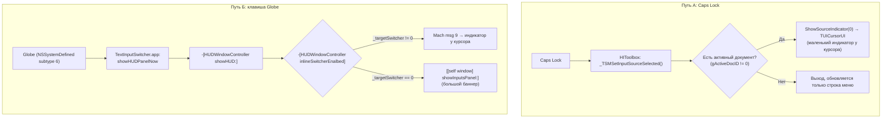
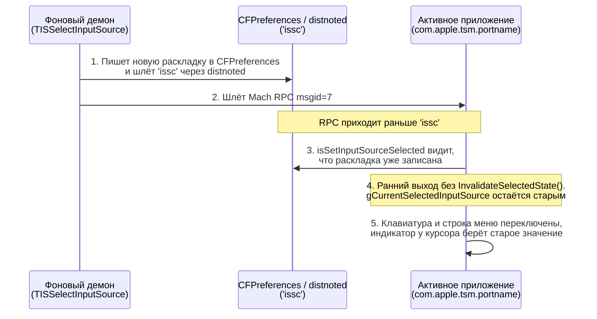

# Globe Switcher для macOS

**[English](README.md) | Русский**

Мгновенное переключение языка клавишей Globe (🌐/Fn) на macOS без большого баннера по центру экрана. Маленький индикатор у курсора, Globe+Delete и Caps Lock остаются, прав Accessibility и Input Monitoring не нужно.

На macOS переключение через Caps Lock мгновенное и никогда не показывает большое окно по центру экрана. Клавиша Globe показывает его (когда курсор не в текстовом поле) и переключает с задержкой. Globe Switcher — небольшой LaunchAgent на Swift, который направляет Globe по тому же пути, что и Caps Lock.

| Большой баннер по центру (убран) | Маленький индикатор у курсора (остался) |
| :---: | :---: |
|  |  |

## Что меняется

| | macOS по умолчанию (Globe) | С Globe Switcher |
| :--- | :--- | :--- |
| Задержка переключения | Заметная | Нет |
| Большой баннер по центру | Появляется, когда курсор не в текстовом поле | Не появляется |
| Индикатор у курсора | Есть | Есть |
| Globe+Delete (Forward Delete), Fn+F1–F12 | Работают | Работают |
| Caps Lock для заглавных | Работает | Работает |
| Права Accessibility / Input Monitoring | Не нужны | Не нужны |
| После перезагрузки | — | Запускается при входе (LaunchAgent) |
| Удаление | — | Одна команда или одно действие в Быстрой команде, исходная настройка возвращается сразу |

## Установка через Быструю команду

[Быстрая команда (iCloud)](https://www.icloud.com/shortcuts/faa3b699eec641aab741d97baf88fe57)

> [!IMPORTANT]
> Перед первым запуском откройте «Команды», нажмите **⌘,** (Настройки), перейдите на вкладку **«Дополнения»** (в других версиях macOS «Дополнительно») и включите **«Запуск скриптов»**. Пока этой галочки нет, macOS блокирует shell-скрипты в Командах. Это нужно сделать один раз. В самой команде есть пункт «Первый запуск» с объяснением, он работает и при выключенных скриптах.


1. На первом экране выберите язык: English (по умолчанию), Español, العربية, 中文 или Русский.
2. Выберите «Включить».
3. Готово. Дальше команда не нужна: демон сам стартует при входе. Открывайте её только чтобы поставить на паузу, проверить статус или удалить.

| Выбор языка | Меню действий | Статус |
| :---: | :---: | :---: |
|  |  |  |

Бинарник внутри команды собран из [`GlobeSwitcher.swift`](GlobeSwitcher.swift) (`swiftc -O -parse-as-library -target arm64-apple-macos13.0`, затем `strip -x`). SHA-256 до локальной ad-hoc подписи:

```text
9314b5ac579fcf08e60c2215249b9f401bbc400d323852079d01368bb11a64cc  globe-switcher
```

Если не хотите запускать готовый бинарник, соберите его сами.

## Сборка из исходников

```zsh
# Нужны Xcode Command Line Tools (Apple Silicon / arm64, macOS 13.0+)
swiftc -O -parse-as-library -target arm64-apple-macos13.0 GlobeSwitcher.swift -o globe-switcher
strip -x globe-switcher
codesign -s - -f globe-switcher

./manage.sh on         # установить LaunchAgent и выставить AppleFnUsageType = 0
./manage.sh status     # состояние демона и HIToolbox
./manage.sh off        # пауза, возвращает стандартное поведение
./manage.sh uninstall  # удалить всё и вернуть исходную настройку
```

## Без скриптов

Это делается одними настройками, я пользовался так несколько лет до написания утилиты:

1. «Системные настройки → Клавиатура → Источники ввода»: включите «Использовать клавишу Caps Lock для переключения источника ввода».
2. «Сочетания клавиш → Клавиши модификации»: назначьте клавише с глобусом действие Caps Lock.

Перестанет работать Globe+Delete, а Caps Lock будет включаться более долгим нажатием.

## Как это устроено

### Почему `TSMLanguageIndicatorEnabled` не помогает

Часто советуют такую команду:

```zsh
defaults write kCFPreferencesAnyApplication TSMLanguageIndicatorEnabled -bool false
```

Она делает наоборот: отключает маленький индикатор у курсора и возвращает большой баннер везде.

### Две ветки

Я разобрал в lldb `TextInputSwitcher.app`, `TextInputMenuUI.framework` и `HIToolbox.framework`. Caps Lock и Globe идут разными путями.



**Путь Б (Globe).** При `AppleFnUsageType = 1` нажатие Globe отправляет в `TextInputSwitcher.app` событие `NSSystemDefined` (`subtype = 6`, `data1 = 0x3e7`). Он вызывает `showHUDPanelNow`, а затем `-[HUDWindowController showHUD:]`. Там проверяется `-[HUDWindowController inlineSwitcherEnalbed]` (опечатка есть в бинарнике Apple). Метод смотрит на фича-флаг `redesigned_text_cursor`, на `TSMLanguageIndicatorEnabled` и на `_targetSwitcher`: это `ProcessSerialNumber` активного приложения, которое регистрируется Mach-сообщением `13`. Если текстового поля в фокусе нет, `_targetSwitcher == 0`, и код безусловно вызывает `showInputsPanel:`. Ключей `defaults` в этой ветке нет.

**Путь А (Caps Lock).** `ProcessCapsLockModifierChangedEvent` выполняется внутри `HIToolbox`, `TextInputSwitcher.app` не участвует. После `_TSMSetInputSourceSelected` вызывается `ShowSourceIndicator(0)`. `ShowSourceIndicator_TimerHandler` сначала читает `gActiveDocID` и выходит, если она равна нулю.

### Что делает демон

Он выставляет `AppleFnUsageType = 0`, чтобы система игнорировала одиночное нажатие Globe, сам обрабатывает нажатие и переключает язык через `HIToolbox`.

**Без разрешений.** Globe+Backspace (Forward Delete), Globe+стрелки и Globe+F-клавиши обрабатывает драйвер клавиатуры до того, как события попадают в пользовательские процессы, поэтому они продолжают работать. Демон использует глобальный монитор `NSEvent` для `.flagsChanged` (работает без TCC), а при отпускании Globe спрашивает у WindowServer, сколько времени прошло с последней клавиши или клика:

```swift
let sinceLastKeyDown = CGEventSource.secondsSinceLastEventType(.combinedSessionState, eventType: .keyDown)
let sinceLastLeftClick = CGEventSource.secondsSinceLastEventType(.combinedSessionState, eventType: .leftMouseDown)
let sinceLastRightClick = CGEventSource.secondsSinceLastEventType(.combinedSessionState, eventType: .rightMouseDown)
```

Эти вызовы не показывают, какая клавиша нажата, поэтому разрешения не нужны, но видно, нажималось ли что-то, пока Globe был зажат. `keyUp` не учитывается, чтобы быстрая печать не срывала переключение. `.capsLock` исключён из маски посторонних модификаторов, поэтому Globe работает и при включённом Caps Lock.

**Гонка в HIToolbox.** Если вызывать `TISSelectInputSource()` из фонового процесса, индикатор у курсора иногда показывал предыдущий язык, хотя строка меню была правильной.



Чтобы этого избежать, демон сам `TISSelectInputSource()` не вызывает. Он находит приложение с фокусом клавиатуры (`SLPSGetKeyFocusProcess` из SkyLight, затем `GetProcessPID`), сериализует целевой источник ввода через `_CreateFlattenedInputSource`, упаковывает в бинарный plist (`{"tsmInputSourceSelectedInpSrcKey": flatDict}`) и отправляет Mach-сообщением `msgid = 7` в порт `com.apple.tsm.portname` этого приложения (`CFMessagePortCreatePerProcessRemote`). Дальше приложение обновляет своё состояние само, в одном потоке.

На arm64e `SLPSGetKeyFocusProcess` принимает два выходных указателя: `ProcessSerialNumber*` в `x0` и `UInt8*` в `x1`. Если объявить функцию с одним аргументом, оптимизированная сборка падает с `EXC_BAD_ACCESS` на `strb w8, [x20]` (+364).

**Мгновенный откат.** `defaults write com.apple.HIToolbox AppleFnUsageType -int 1` не заставляет системные процессы перечитать настройку. `TISUpdateFnUsageType(Int32)` записывает значение и рассылает `BroadcastToolboxMessage('fnsc', 0)`, поэтому включение, пауза и удаление применяются без перезагрузки.

**Упаковка в Быструю команду.** Бинарник хранится как `gzip -9` и `base64` (около 17 КБ). При установке он распаковывается в `$BIN_PATH.tmp.$$`, подписывается встроенным `/usr/bin/codesign -s - -f` и ставится на место через `mv -f`. Перезапись существующего исполняемого файла на Apple Silicon может привести к `SIGKILL`, потому что кэш подписи привязан к vnode файла.

## FAQ

**Как убрать большое окно переключения языка на macOS и оставить маленький индикатор у курсора?**
Поставьте Globe Switcher (Быстрая команда или сборка из исходников). Он направляет клавишу Globe по тому же пути, что Caps Lock.

**Нужны ли права Accessibility или Input Monitoring?**
Нет.

**Работает ли Globe+Delete?**
Да. Globe+Delete, Globe+стрелки и Fn+F-клавиши обрабатывает драйвер клавиатуры.

**Переживёт ли перезагрузку?**
Да, это обычный пользовательский LaunchAgent (`local.globe-switcher`), он стартует при входе.

**А если macOS изменится?**
Утилита использует закрытые системные функции, поэтому новая версия macOS может её сломать. Тогда выполните «Полный откат», чтобы вернуть исходную настройку, и создайте issue.

**Как удалить?**
Запустите Быструю команду и выберите «Полный откат» или выполните `./manage.sh uninstall`.

## Файлы

- [`GlobeSwitcher.swift`](GlobeSwitcher.swift): демон, один файл, без зависимостей.
- [`manage.sh`](manage.sh): установка, статус, пауза и удаление.
- [`local.globe-switcher.plist`](local.globe-switcher.plist): пользовательский агент launchd.
- [`shortcut-all-in-one.sh`](shortcut-all-in-one.sh): скрипт, встроенный в Быструю команду.
- [`Globe Switcher.shortcut`](Globe%20Switcher.shortcut): подписанная Быстрая команда.

## Лицензия

MIT.

## Автор

Владислав Касаткин (`vladkas`). История создания и способ без скриптов: [vladkas.com](https://vladkas.com/blog/globe-switcher-shortcut/).
