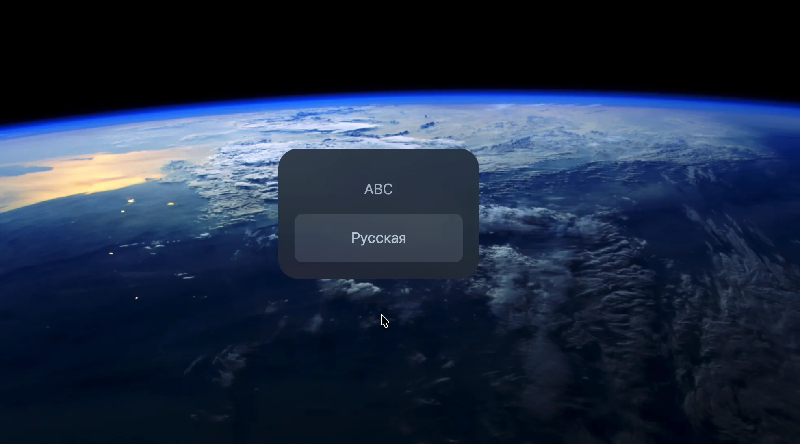
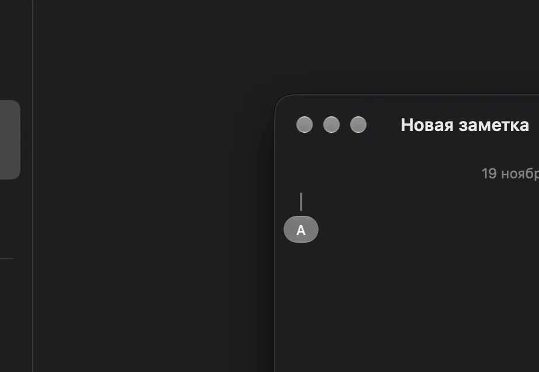
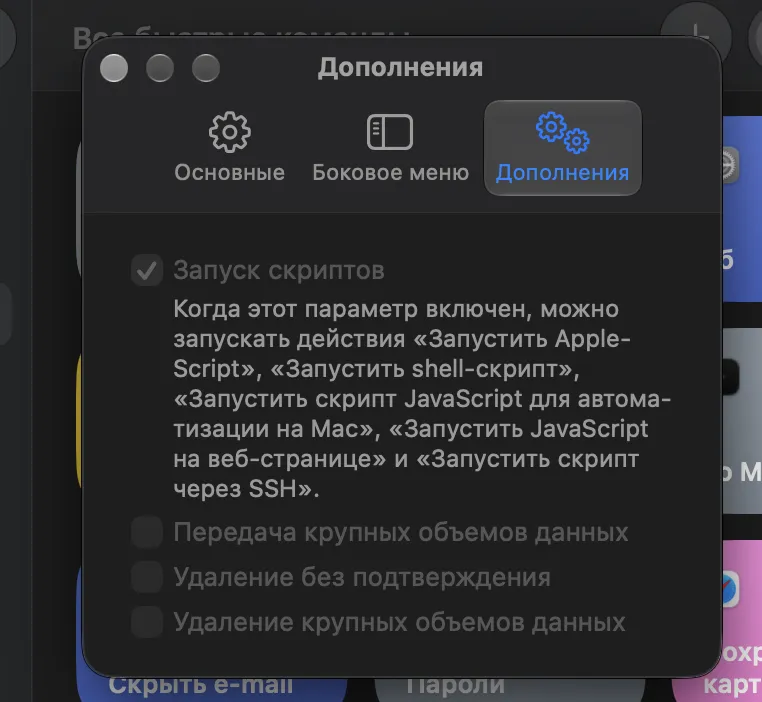
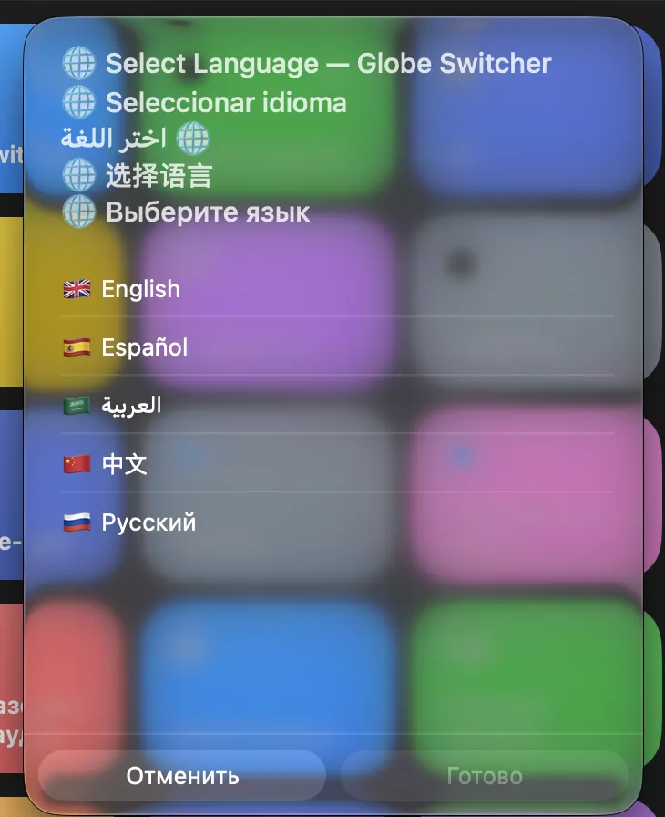
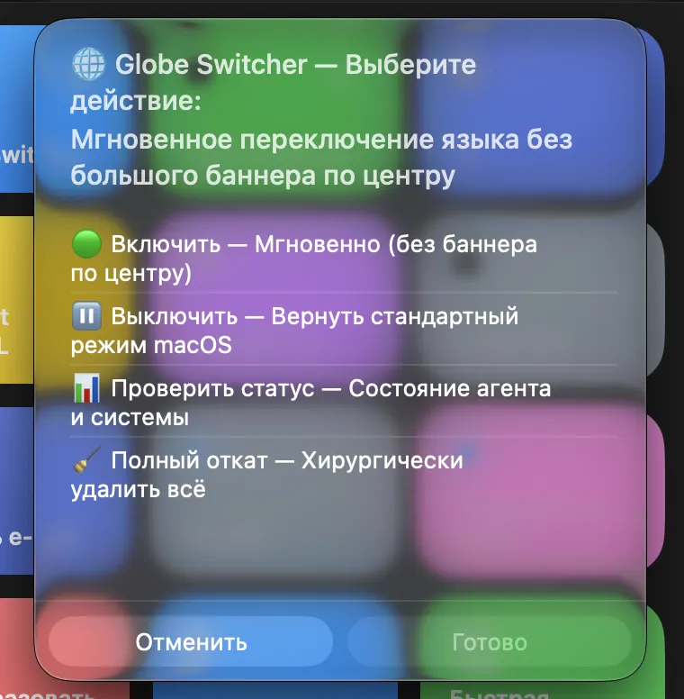
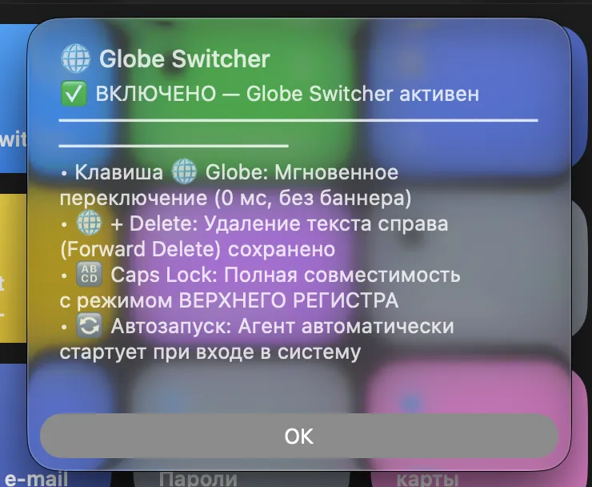
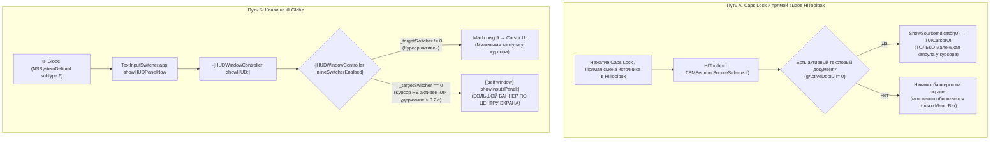
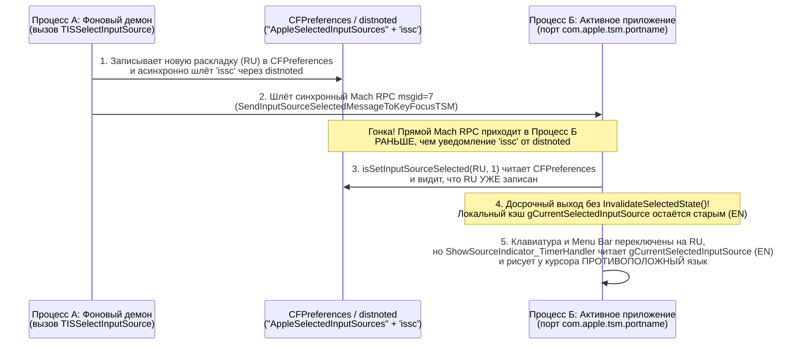

# 🌐 Globe Switcher for macOS

**🇬🇧 [English](README.md) | 🇷🇺 Русский**

[](#)
[-blue)](#)
[](#zero-tcc-как-отличить-globe-от-globe--delete-без-прав-доступности)
[](#лицензия)

**Мгновенное (`0 мс`) переключение раскладки клавишей `🌐 Globe` (`Fn`) без большого баннера по центру экрана, но с сохранением маленькой капсулы у текстового курсора, `🌐 + Delete` (Forward Delete), режима `Caps Lock` и нулевыми системными разрешениями (Zero-TCC).**

| ❌ Большой баннер по центру (Убран) | ✅ Маленькая капсула у курсора (Сохранена) |
| :---: | :---: |
|  |  |

---

## ✨ Возможности

| Функция | Стандартная macOS (`🌐 Globe`) | **Globe Switcher** |
| :--- | :---: | :---: |
| **Задержка переключения** | Задержка + анимация HUD | **0 мс (мгновенно)** |
| **Большой баннер по центру экрана** | Постоянно всплывает вне полей ввода | **Никогда не появляется** |
| **Маленькая капсула у текстового курсора** | Есть | **Сохранена (нативная `TUICursorUI`)** |
| **Комбинация `🌐 Globe + Delete` (Forward Delete)** | Работает | **Работает штатно** |
| **Совместимость с `Caps Lock` (ВЕРХНИЙ РЕГИСТР)** | Работает | **Работает штатно** |
| **Разрешения Accessibility / Input Monitoring** | — | **Не требуются (Zero-TCC)** |
| **Автозапуск после перезагрузки Mac** | — | **Да (`LaunchAgent`, `0.0% CPU`, ~3 МБ RAM)** |
| **Полный хирургический откат без перезагрузки** | — | **Да, в 1 клик (мгновенно)** |

---

## 🚀 Быстрая установка (через Быстрые команды iCloud)

Самый простой способ установить и управлять демоном без Терминала и Xcode — добавить готовую автономную Быструю команду:

👉 **[Установить Globe Switcher (iCloud Shortcut)](https://www.icloud.com/shortcuts/6fd29c90d5bf44518194368ff03fc031)**

> [!IMPORTANT]
> **Сделайте это ДО первого запуска команды:**
> По умолчанию на macOS приложение **«Команды» (Shortcuts)** блокирует выполнение shell-скриптов. Откройте **«Команды»**, нажмите **`⌘,`** (Настройки) → **Дополнительно** (*Дополнения*) → поставьте галочку **«Разрешить запуск скриптов»** (*Запуск скриптов*).
> Это безопасно и нужно сделать всего один раз — без этой галочки команда не запустится. *(Внутри самой команды также есть не-скриптовый пункт **🔓 Первый запуск? Разрешить скрипты (10 сек)** с пошаговой подсказкой.)*



### Что полезно знать

1. **Поддержка 5 языков интерфейса:**
   На первом шаге команда предлагает выбрать язык UI:
   `🇬🇧 English` (по умолчанию) · `🇪🇸 Español` · `🇸🇦 العربية` · `🇨🇳 中文` · `🇷🇺 Русский`.

| Выбор языка | Меню действий | Статус работы |
| :---: | :---: | :---: |
|  |  |  |

2. **Команда нужна только один раз:**
   После нажатия **🟢 Включить** команда устанавливает нативный бинарник в `~/.local/share/globe-switcher/` и регистрирует системный `LaunchAgent` (`~/Library/LaunchAgents/local.globe-switcher.plist`). **Скрипт будет работать в фоне автоматически даже после перезагрузки Mac** — запускать Быструю команду снова не нужно. Она пригодится только если вы захотите поставить утилиту на паузу (**⏸️ Выключить**), проверить статус (**📊 Статус**) или выполнить **🧹 Полный откат**.

3. **Проверка встроенного бинарника (SHA-256):**
   Бинарник `arm64`, встроенный в Быструю команду, собран напрямую из [`GlobeSwitcher.swift`](GlobeSwitcher.swift) (`swiftc -O -parse-as-library` + `strip -x`). Контрольная сумма до локальной ad-hoc подписи:
   ```text
   2015eb73f5a57648a765f403716528170f27445c331b3ec2cad4c2d363e57ee1  globe-switcher
   ```
   *(При желании вы можете проверить код и собрать [`GlobeSwitcher.swift`](GlobeSwitcher.swift) самостоятельно по инструкции ниже.)*

---

## 🛠️ Установка из исходного кода (для разработчиков)

Вы можете проверить каждую строчку кода в [`GlobeSwitcher.swift`](GlobeSwitcher.swift), скомпилировать бинарник самостоятельно и управлять им через [`manage.sh`](manage.sh):

```zsh
# 1. Компиляция нативного бинарника (требуется Command Line Tools / Xcode)
swiftc -O -parse-as-library GlobeSwitcher.swift -o globe-switcher
strip -x globe-switcher
codesign -s - -f globe-switcher

# 2. Включение (устанавливает LaunchAgent и переключает AppleFnUsageType = 0)
./manage.sh on

# Проверка статуса
./manage.sh status

# Пауза (мгновенно возвращает стандартный HUD macOS)
./manage.sh off

# Полный хирургический откат (удаляет бинарник, plist и возвращает исходные настройки)
./manage.sh uninstall
```

---

## 🔬 Техническое расследование: как устроено переключение языка в macOS

### 1. Парадокс `Caps Lock` vs `🌐 Globe` и миф о `TSMLanguageIndicatorEnabled`

Начиная с macOS Sonoma, в системе сосуществуют два визуальных индикатора раскладки:
1. **Маленькая капсула рядом с текстовым курсором** (`TUICursorUI`) — появляется только при активной каретке ввода.
2. **Большой центральный баннер со списком раскладок** (`HUDPanel`) — всплывает по центру экрана каждый раз, когда курсор неактивен (на Рабочем столе, в Finder, в браузере вне текстового поля), добавляя задержку.

При этом, если назначить переключение языка на **`Caps Lock`**, большой баннер **не появляется никогда** — при активном курсоре рисуется только маленькая капсула, а без курсора язык мгновенно меняется только в строке меню (Menu Bar).

Популярный в сети совет:
```zsh
defaults write kCFPreferencesAnyApplication TSMLanguageIndicatorEnabled -bool false
```
работает **ровно наоборот**: этот ключ отключает *новый маленький индикатор у курсора* и принудительно возвращает *старый большой баннер* во всех случаях.

### 2. Открытие: два совершенно разных архитектурных пути внутри macOS

Дизассемблирование в `lldb` трёх системных компонентов из `dyld_shared_cache` — **`TextInputSwitcher.app`**, **`TextInputMenuUI.framework`** и **`HIToolbox.framework`** — показало, почему `Caps Lock` и `🌐 Globe` ведут себя по-разному:



#### Почему в Пути Б (`🌐 Globe`) большой баннер нельзя отключить через `defaults`:
1. При `AppleFnUsageType = 1` нажатие `🌐 Globe` отправляет в `TextInputSwitcher.app` системное событие `NSSystemDefined` (`subtype = 6`, `data1 = 0x3e7`).
2. `TextInputSwitcher` вызывает `showHUDPanelNow` → `-[HUDWindowController showHUD:]`.
3. Внутри `showHUD:` проверяется метод **`-[HUDWindowController inlineSwitcherEnalbed]`** *(оригинальная опечатка инженеров Apple в слове `Enalbed` в бинарнике `TextInputMenuUI`)*. Он проверяет фича-флаг `_os_feature_enabled_impl("UIKit", "redesigned_text_cursor")`, `TSMLanguageIndicatorEnabled` и поле **`self->_targetSwitcher`** (`ProcessSerialNumber` активного приложения, присылаемый через Mach-сообщение `13` — `@"register switcher"`).
4. Когда текстового курсора нет (`_targetSwitcher == 0`), `inlineSwitcherEnalbed` возвращает `NO`, и код **жёстко (hardcoded), без проверки каких-либо ключей `defaults`**, вызывает:
   ```objc
   [[self window] setCollectionBehavior:0x401];
   [[self window] showInputsPanel:selectionIndex];
   ```

#### Почему в Пути А (`Caps Lock`) большого баннера не существует в принципе:
`ProcessCapsLockModifierChangedEvent` выполняется **внутри `HIToolbox.framework`**, минуя `TextInputSwitcher.app`. После `_TSMSetInputSourceSelected` вызывается `ShowSourceIndicator(0)` → `ShowSourceIndicator_TimerHandler`. Первой же инструкцией проверяется глобальная переменная `gActiveDocID`:
- если `gActiveDocID == 0` (нет активного текстового поля) — функция немедленно завершается (`retab`);
- если `gActiveDocID != 0` — запрашиваются координаты каретки (`SendTextInputOffsetToPosEvent_WithCompletionHandler`) и рисуется **только маленькая капсула у курсора**.

---

## 🧠 Ключевые инженерные решения в `GlobeSwitcher.swift`

Чтобы перевести клавишу `🌐 Globe` на **Путь А**, демон выставляет `AppleFnUsageType = 0` («Ничего не делать» для одиночного нажатия `🌐`), перехватывает одиночное нажатие `🌐` сам и инициирует нативное переключение в `HIToolbox`.

### 1. Zero-TCC: как отличить `🌐 Globe` от `🌐 Globe + Delete` без прав доступности
Обычные утилиты ремаппинга требуют прав **Accessibility** или **Input Monitoring**, так как используют `CGEventTap` или `IOHIDManager`. `globe-switcher` обходится **без единого разрешения TCC**:
- Трансляция аккордов `🌐 + Backspace → Forward Delete (0x75)`, `🌐 + стрелки → Home/End/PageUp/PageDown` и `🌐 + F1..F12` происходит **на уровне ядра / HID-драйвера** (`AppleHIDKeyboardEventDriverV2`) до User Space, поэтому `AppleFnUsageType = 0` их не ломает.
- AppKit доставляет события `NSEvent.addGlobalMonitorForEvents(matching: .flagsChanged)` (включая `🌐 Globe`, `keyCode == 63`) любому фоновому процессу **без прав TCC**.
- В момент отпускания `🌐 Globe` демон запрашивает у `WindowServer` публичный монотонный счётчик времени с последнего нажатия любой клавиши или клика мыши:
  ```swift
  let sinceLastKeyDown = CGEventSource.secondsSinceLastEventType(.combinedSessionState, eventType: .keyDown)
  let sinceLastLeftClick = CGEventSource.secondsSinceLastEventType(.combinedSessionState, eventType: .leftMouseDown)
  let sinceLastRightClick = CGEventSource.secondsSinceLastEventType(.combinedSessionState, eventType: .rightMouseDown)
  ```
  Этот API не раскрывает, *какая* клавиша была нажата (поэтому не требует TCC), но позволяет с точностью до миллисекунд определить, нажимал ли пользователь `Delete` (или другую клавишу) во время удержания `🌐`. Событие `.keyUp` намеренно не учитывается, чтобы не блокировать переключение при быстрой слепой печати.
- Флаг `.capsLock` (`0x10000`) исключён из маски посторонних модификаторов `otherModifiers = [.command, .option, .control, .shift]`, поэтому переключение языка по `🌐 Globe` безотказно работает даже при включённом `Caps Lock`.

### 2. Устранение IPC-гонки в `HIToolbox` (баг «противоположного языка» у курсора)
Если вызывать `TISSelectInputSource()` напрямую из фонового демона, иногда возникает редкая межпроцессная гонка (IPC Race Condition) внутри `HIToolbox` от Apple: иконка в Menu Bar и реальный ввод переключаются правильно, но маленькая капсула у курсора показывает **предыдущий (противоположный) язык**.



**Хирургическое решение — прямое делегирование KeyFocus-процессу:**
Вместо того чтобы перезаписывать `CFPreferences` из фонового демона, `globe-switcher` делегирует переключение **напрямую активному процессу с клавиатурным фокусом (`KeyFocus Process`)**:
1. Получает `ProcessSerialNumber` и `pid_t` активного процесса через `SLPSGetKeyFocusProcess` (`SkyLight.framework`) и `GetProcessPID`.
   > **Деталь ABI `arm64e`:** в `SkyLight.framework` функция `SLPSGetKeyFocusProcess` принимает **два** выходных указателя: `UnsafeMutablePointer<ProcessSerialNumber>` (`x0`) и `UnsafeMutablePointer<UInt8>` (`x1`). Если передать только один аргумент, в оптимизированной сборке (`swiftc -O`) инструкция `strb w8, [x20]` (`+364`) приводит к `EXC_BAD_ACCESS`.
2. Сериализует целевой `TISInputSource` через `_CreateFlattenedInputSource`, упаковывает в бинарный `CFPropertyList` (`{"tsmInputSourceSelectedInpSrcKey": flatDict}`) и отправляет Mach-сообщением **`msgid = 7`** напрямую в порт **`"com.apple.tsm.portname"`** активного приложения через `CFMessagePortCreatePerProcessRemote`.
3. Активное приложение синхронно, в одном потоке инвалидирует свой кэш `gCurrentSelectedInputSource`, обновляет `CFPreferences`, Menu Bar и рисует капсулу у курсора. Гонка физически невозможна.

### 3. Мгновенный откат без перезагрузки (`TISUpdateFnUsageType`)
Обычная команда `defaults write com.apple.HIToolbox AppleFnUsageType -int 1` не вступает в силу до перезагрузки, так как системные демоны кэшируют значение. Дизассемблирование `HIToolbox` (`islUpdateFnUsageType`) показало, что системные настройки вызывают функцию `TISUpdateFnUsageType(Int32)`, которая после записи в `CFPreferences` рассылает широковещательное сообщение **`BroadcastToolboxMessage('fnsc', 0)`**. Вызов этого символа напрямую через `@_silgen_name("TISUpdateFnUsageType")` позволяет включать, выключать и откатывать утилиту мгновенно (за `0` секунд).

### 4. Автономная упаковка и защита от `vnode cs_blob` в XNU
Внутри Быстрой команды скомпилированный и очищенный (`strip -x`) `arm64`-бинарник сжат в `gzip -9` + `base64` (~17 КБ). При установке скрипт:
- распаковывает бинарник во временный файл `$BIN_PATH.tmp.$$`;
- подписывает его локально встроенной в macOS утилитой `/usr/bin/codesign -s - -f`;
- атомарно заменяет файл через `mv -f` (перезапись существующего inode на Apple Silicon приводит к конфликту кэша кодовой подписи `vnode cs_blob` в ядре XNU и `SIGKILL`).

---

## 📁 Структура репозитория

- [`GlobeSwitcher.swift`](GlobeSwitcher.swift) — полный исходный код фонового демона (Swift, без сторонних зависимостей).
- [`manage.sh`](manage.sh) — CLI-скрипт для установки, проверки статуса, паузы и полного отката.
- [`local.globe-switcher.plist`](local.globe-switcher.plist) — конфигурация `LaunchAgent` (`ProcessType = Interactive`, `KeepAlive = true`).
- [`shortcut-all-in-one.sh`](shortcut-all-in-one.sh) — автономный скрипт со встроенным payload для Быстрой команды.
- [`Globe Switcher.shortcut`](Globe%20Switcher.shortcut) — подписанная Apple Быстрая команда (5 языков + онбординг первого запуска).

---

## 📄 Лицензия

Проект распространяется под свободной лицензией **MIT** — вы можете свободно использовать, изучать, модифицировать и распространять код.

## 👤 Автор

**Владислав Касаткин** (`vladkas`) — [История создания и штатный способ без скриптов в блоге vladkas.com](https://vladkas.com/blog/globe-switcher-shortcut/).
